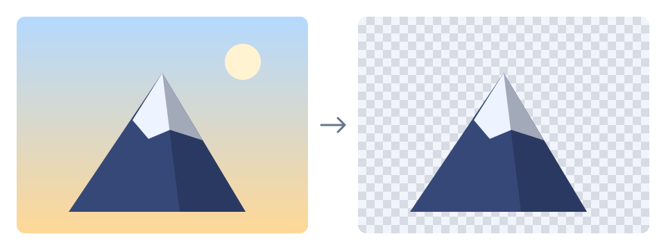

A layer mask hides pixels while keeping the original image available. Start with a raster layer; editable text does not support layer masks.

## Select the subject {#steps}

1. Open the image and select its layer in **Layers**.
2. Choose **Magic Wand** (`W`) for a connected background, or **Free Select** (`F`) to trace the subject. With Free Select, click for corners or drag for a freehand outline, then click the start or press Return to close it.
3. If you selected the background, choose **Select → Invert Selection**. The selection must cover the part you want to keep.
4. Refine the edge with **Select → Grow…**, **Shrink…**, or **Feather…** as needed. Start with a small feather radius; a large radius can fade fine detail.
5. Choose **Layer → Mask → From Selection**, then **Select → Select None** to inspect the result.

## Expected result {#result}

The background becomes transparent, shown by the checkerboard. The subject remains visible. Save a **`.lime`** project to retain both original pixels and the mask; export PNG or WebP for a flattened image with transparency.

*Illustration: the mask controls visibility; it does not erase the source pixels.*

## Refine or restore {#refine}

Use **Layer → Mask → Mask to Selection** to recover the mask as a selection, refine it, then create the mask again with **From Selection**. There is no separate brush target for painting on a mask.

**Enable / Disable** temporarily compares the original image. **Remove** restores visibility without deleting source pixels. **Apply** makes the hidden areas permanently transparent in the layer's pixels; undo restores the prior mask while that edit remains in history.

## Troubleshooting {#troubleshooting}

If the subject disappears, the selection was reversed: use **Layer → Mask → Invert**. If the wand reaches inside the subject, lower **Tolerance** or try a small **Gap radius**. Gap closure may also seal narrow passages; undo and compare the result.

## Related guides {#related}

- [Selections and soft edges](../../basics/selections/)
- [Layer masks](../../basics/masks/)
- [Save and export](../../reference/files/)
