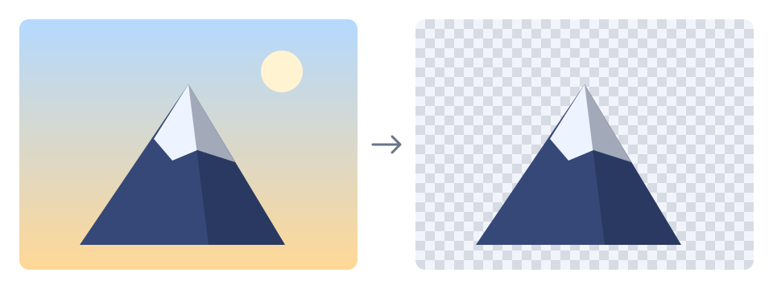

Layer Mask က မူရင်းပုံ၏ Pixel များကို မဖျက်ဘဲ ဖျောက်ပေးသည်။ Raster Layer ဖြင့် စပါ။ Editable Text တွင် Layer Mask မသုံးနိုင်ပါ။

## ချန်ထားလိုသောအပိုင်း ရွေးရန် {#steps}

1. ပုံကို ဖွင့်ပြီး **Layers** တွင် ပြင်မည့် Layer ကို ရွေးပါ။
2. ဆက်နေသောနောက်ခံကို ရွေးရန် **Magic Wand** (`W`) သုံးပါ။ ပုံထဲမှ အရာဝတ္ထုပတ်လည် ကိုယ်တိုင်ဆွဲရန် **Free Select** (`F`) သုံးပါ။ Free Select တွင် ထောင့်များကို Click လုပ်ပါ၊ သို့မဟုတ် ဖိဆွဲပြီး Outline ဆွဲပါ။ စမှတ်ကို Click လုပ်ခြင်း သို့မဟုတ် Return နှိပ်ခြင်းဖြင့် ပိတ်ပါ။
3. နောက်ခံကို ရွေးထားလျှင် **Select → Invert Selection** လုပ်ပါ။ Selection က ချန်ထားလိုသောအပိုင်းကို ဖုံးရမည်။
4. လိုအပ်လျှင် **Select → Grow…**၊ **Shrink…** သို့မဟုတ် **Feather…** ဖြင့် Selection ပြင်ပါ။ Feather radius ကို နည်းနည်းဖြင့် စမ်းပါ။ များလွန်းလျှင် အသေးစိတ်များ ဖျော့သွားနိုင်သည်။
5. **Layer → Mask → From Selection** ရွေးပါ။ ရလဒ်ကြည့်ရန် **Select → Select None** လုပ်ပါ။

## ရလဒ် {#result}

နောက်ခံသည် Transparent ဖြစ်သွားပြီး Checkerboard ပေါ်လာမည်။ ရွေးထားသောအရာသာ ကျန်မည်။ မူရင်း Pixel နှင့် Mask ကို ထိန်းရန် **`.lime`** Project အဖြစ် Save လုပ်ပါ။ Transparency ပါသော ပုံလိုလျှင် PNG သို့မဟုတ် WebP ဖြင့် Export လုပ်ပါ။

*သရုပ်ဖော်ပုံ — Mask က မြင်ရသည့်နေရာကို ထိန်းပေးပြီး မူရင်း Pixel များကို မဖျက်ပါ။*

## Mask ပြန်ပြင်ရန် သို့မဟုတ် ဖယ်ရန် {#refine}

**Layer → Mask → Mask to Selection** ဖြင့် Mask ကို Selection အဖြစ် ပြန်ယူပါ။ Selection ပြင်ပြီး **From Selection** ဖြင့် Mask ပြန်လုပ်ပါ။ Mask ပေါ်တွင် Brush ဖြင့် တိုက်ရိုက်ပုံဆွဲနိုင်သော Target မရှိပါ။

**Enable / Disable** ဖြင့် မူရင်းပုံနှင့် ယာယီနှိုင်းယှဉ်နိုင်သည်။ **Remove** က မူရင်း Pixel မဖျက်ဘဲ Mask ဖယ်ပေးသည်။ **Apply** က ဖျောက်ထားသောနေရာကို Layer ၏ Pixel ထဲတွင် Transparent အဖြစ် ပြောင်းပေးသည်။ ထို Edit က History တွင် ရှိနေသေးလျှင် Undo ဖြင့် Mask ပြန်ယူနိုင်သည်။

## ပြဿနာအဖြေရှာရန် {#troubleshooting}

အရာဝတ္ထုပျောက်သွားလျှင် Selection ပြောင်းပြန်ဖြစ်နေသည်။ **Layer → Mask → Invert** လုပ်ပါ။ Wand က အရာဝတ္ထုအတွင်းထိ ရွေးသွားလျှင် **Tolerance** လျှော့ပါ၊ သို့မဟုတ် **Gap radius** နည်းနည်း စမ်းပါ။ Gap radius က ကျဉ်းသောနေရာများကိုပါ ပိတ်နိုင်သဖြင့် Undo လုပ်ပြီး နှိုင်းယှဉ်ပါ။

## ဆက်ဖတ်ရန် {#related}

- [Selection၊ Antialias နှင့် Feather](../../basics/selections/)
- [Layer mask သုံးရန်](../../basics/masks/)
- [Project Save နှင့် ပုံ Export](../../reference/files/)
