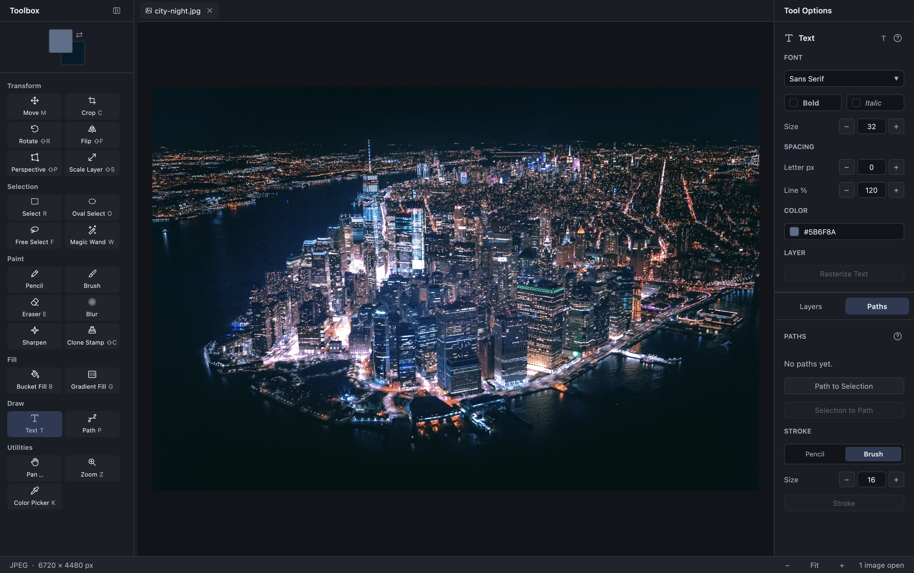

## Workspace ကို ကြည့်ရန် {#layout}

ပုံထဲတွင် Lime ၏ Desktop workspace ကို ပြထားသည်။ သုံးနေသောစက်တွင် Panel အရွယ်နှင့် ရွေးထားသော Tool ကွာနိုင်သည်။

- **ဘယ်ဘက် Toolbox:** သုံးမည့် Tool ကို ရွေးပါ။ Foreground နှင့် Background Color swatch များက အပေါ်ဆုံးတွင် ရှိသည်။
- **အလယ် Canvas:** ပုံကို ကြည့်ပြီး ပြင်သည့်နေရာဖြစ်သည်။ ဖွင့်ထားသော Document တစ်ခုစီတွင် Tab ရှိသည်။ Checkerboard က Transparent နေရာကို ပြသည်။ ပုံထဲတွင် ပါသော နောက်ခံ မဟုတ်ပါ။
- **ညာဘက် Tool Options:** လက်ရှိ Tool ၏ Settings ကို ပြင်ပါ။ **?** ပေါ် Pointer တင်ပြီး အသုံးပြုပုံနှင့် Shortcut များ ကြည့်ပါ။ Secondary settings အုပ်စုများကို Header မှ ခေါက်ထားနိုင်သည်။
- **ညာဘက် Layers / Paths:** ပြင်မည့် Layer ကို ရွေးပါ။ Curve များ စီမံရန် **Paths** သို့ ပြောင်းပါ။ အခြား Layers မြင်နေရသော်လည်း Pixel ပြင်ဆင်မှုအများစုက Active layer ကိုသာ သက်ရောက်သည်။
- **Application menus:** Open၊ Save၊ Export၊ Undo စသည်တို့ကို Menu တွင် ရှာပါ။ Canvas အပေါ်တွင် Editing toolbar မရှိပါ။

## Canvas အတွက် နေရာချဲ့ရန် {#steps}

1. Docked panels ကို အရွယ်ပြင်ပါ သို့မဟုတ် Toolbox ကို ခေါက်ပါ။
2. **View → Toggle Right Sidebar**၊ Sidebar header ခလုတ် သို့မဟုတ် **Cmd/Ctrl+Shift+L** ဖြင့် Tool Options နှင့် Layers/Paths ကို အတူခေါက်ပါ။
3. ညာဘက် Rail ရှိ ခလုတ်ဖြင့် ပြန်ဖွင့်ပါ။ Drag လုပ်နေစဉ် ခေါက်မရသဖြင့် အရင် အဆုံးသတ်ပါ။ ဆွဲခြင်းရပ်ထားသော Transform preview ရှိစဉ် ခေါက်နိုင်သည်။
4. **Space** ကို ဖိထားပြီး ဆွဲကာ Pan လုပ်ပါ။ Pixel မပြောင်းဘဲ ချဲ့ကြည့်ရန် **Zoom** ကို သုံးပါ။

Panel ခေါက်ထားမှုကို Lime က မှတ်ထားသည်။ Tab တစ်ခုစီက Zoom နှင့် Pan ကို သီးခြား မှတ်ထားသည်။ Sidebar ခေါက်လည်း ရွေးထားသော Layers/Paths tab နှင့် Draft များ မပျောက်ပါ။

## Menu သုံးရန် {#menus}

macOS တွင် System menu bar၊ Windows တွင် Native window menu ကို သုံးသည်။ Linux တွင် Window အတွင်း Menu bar ရှိပြီး **F10** ဖြင့် Focus လုပ်နိုင်သည်။ ထို Linux Menu တွင် Arrow keys ဖြင့် ရွှေ့ပါ၊ **Enter** ဖြင့် ရွေးပြီး **Escape** ဖြင့် ပိတ်ပါ။ မျဉ်းသားထားသော စာလုံးများက Menu shortcut ကို ပြသည်။

## ဆက်ဖတ်ရန် {#related}

- [ပထမဆုံး ပုံပြင်ရန်](../../start/first-edit/)
- [Layers နှင့် Transparency](../../basics/layers/)
- [Keyboard shortcuts](../../reference/shortcuts/)
